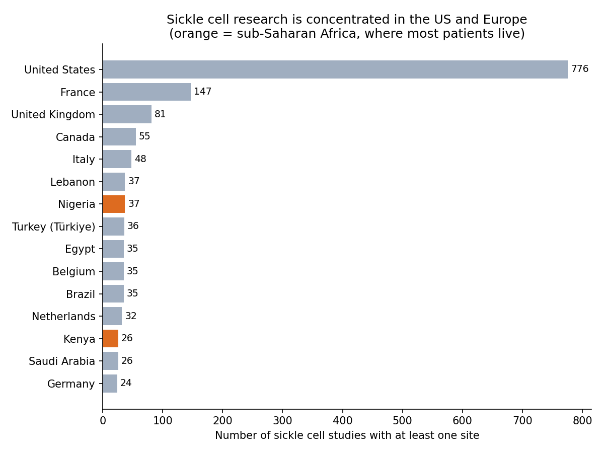
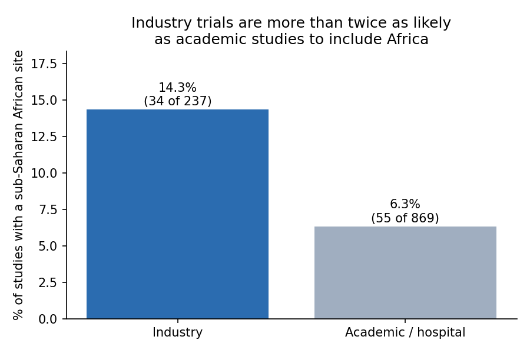
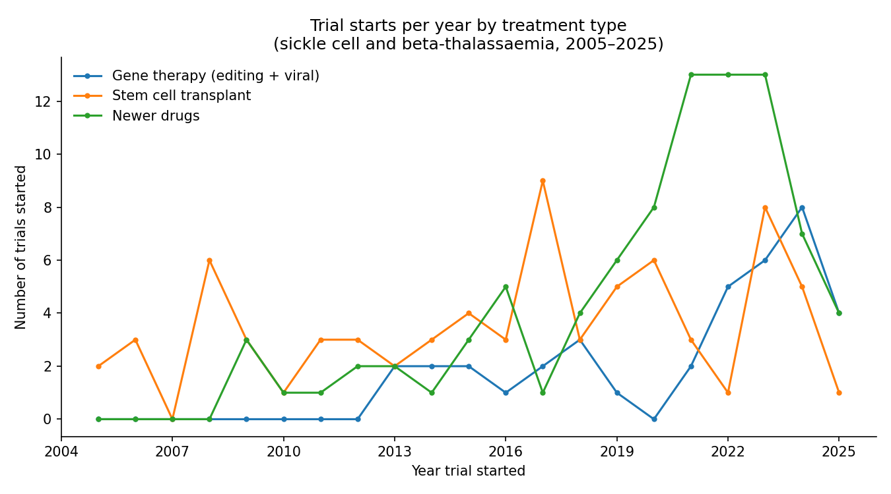

# Sickle cell disease and beta-thalassaemia trials on ClinicalTrials.gov

I wanted to know where research on these two inherited blood disorders is done, who pays for it and which treatments are being tested. This repository pulls every study for both conditions from the [ClinicalTrials.gov API](https://clinicaltrials.gov/data-api/api), puts them into three linked tables and analyses them in Python.

## Findings

1. Only 93 of 1,221 sickle cell studies (7.6%) have a site in sub-Saharan Africa, where most people with the disease live. Nigeria, which has more patients than any other country, appears in 37. India is not in the top 15 countries at all.
2. Industry sponsors 237 of the 1,221 sickle cell studies (19%). Universities, hospitals and governments run the rest.
3. Industry studies include an African site more often than academic ones: 34 of 237 (14.3%) against 55 of 869 (6.3%). My guess is that large multinational Phase 3 trials explain this, since they recruit across many countries. I haven't tested that yet.
4. Industry sponsors 30.9% of thalassaemia-only studies, compared with 19.0% for sickle cell.
5. My keyword rules found no gene therapy study starting between 2005 and 2012. Starts went from 0 in 2020 to 8 in 2024.

## Method

1. Downloaded all studies for both conditions through the API, a page of 1,000 at a time (1,221 sickle cell, 365 thalassaemia).
2. Removed the 83 studies that both searches returned, leaving 1,503.
3. Built three tables joined by NCT ID: one row per trial (phase, sponsor type, start year, whether children can enrol), one per trial and country, and one per trial and intervention.
4. Joined multi-phase labels into one value (PHASE2/PHASE3) and marked observational studies, which have no phase field, as "No phase".
5. Sorted the free-text intervention names into 16 categories with keyword rules. After each round I read the most common unclassified names and added rules, which took the unclassified share from 65% to 44% to 38%. Drug code names are mapped to their approved names, so GBT440 counts as voxelotor.
6. Made the charts with pandas and matplotlib.

## Limitations

The condition search returns any study that lists sickle cell disease or beta-thalassaemia, so the counts include studies of sickle cell trait and transplant studies covering several blood disorders.

Sponsor type is based on the lead sponsor only. A company that funds a study as a collaborator is not counted as industry.

Trials registered only on regional registries such as PACTR (Africa) or CTRI (India) are missing, so the gaps for those regions may look bigger than they are.

38% of interventions are still unclassified. Most are drugs that appear fewer than 7 times each.

Trials are often registered after they start, so 2025 is probably under-counted.

The yearly counts by treatment type are in single digits. A difference of one or two trials can change a line noticeably.

## Running it

Open `sickle_cell_trials.ipynb` in [Google Colab](https://colab.research.google.com) and choose Runtime → Run all. The API needs no key. The code uses Python, pandas, matplotlib and regular expressions.

Chidera Obiajunwa, MSc Health Data Science, UCL
